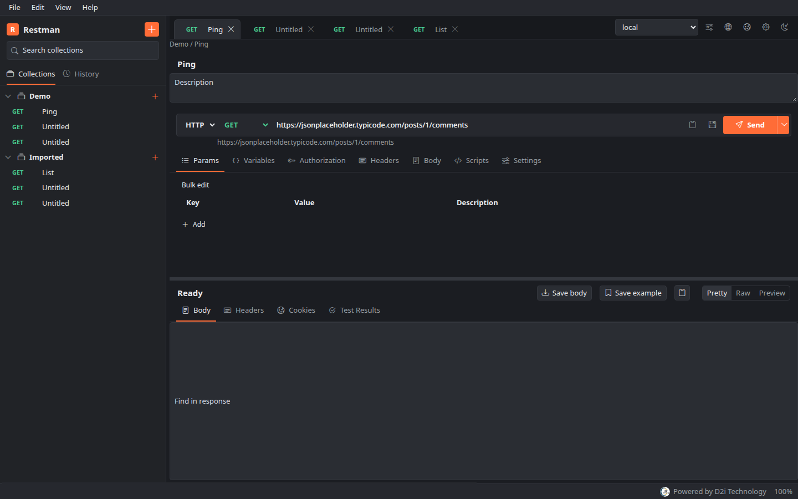
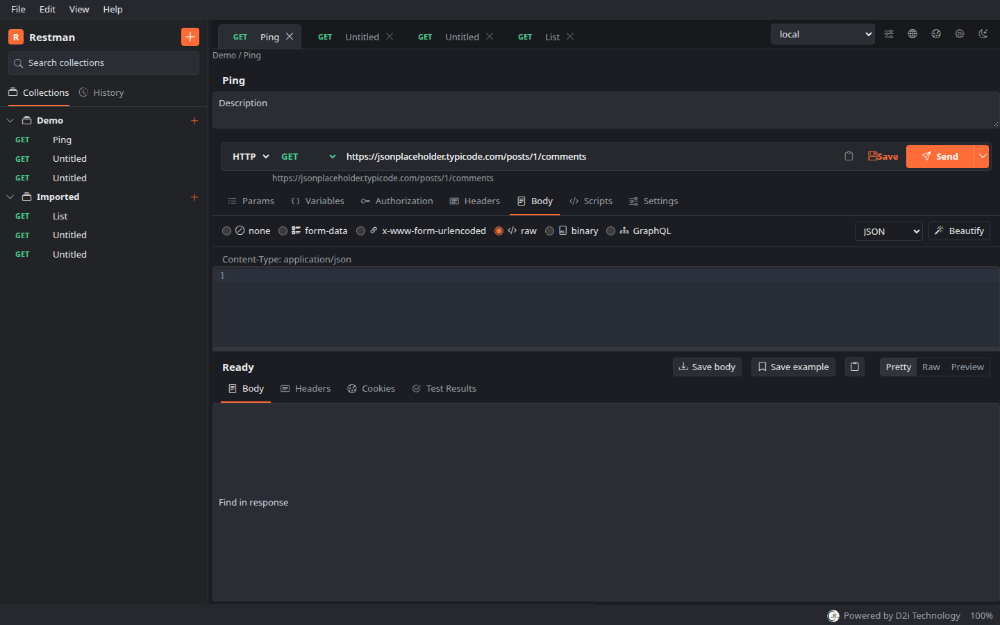
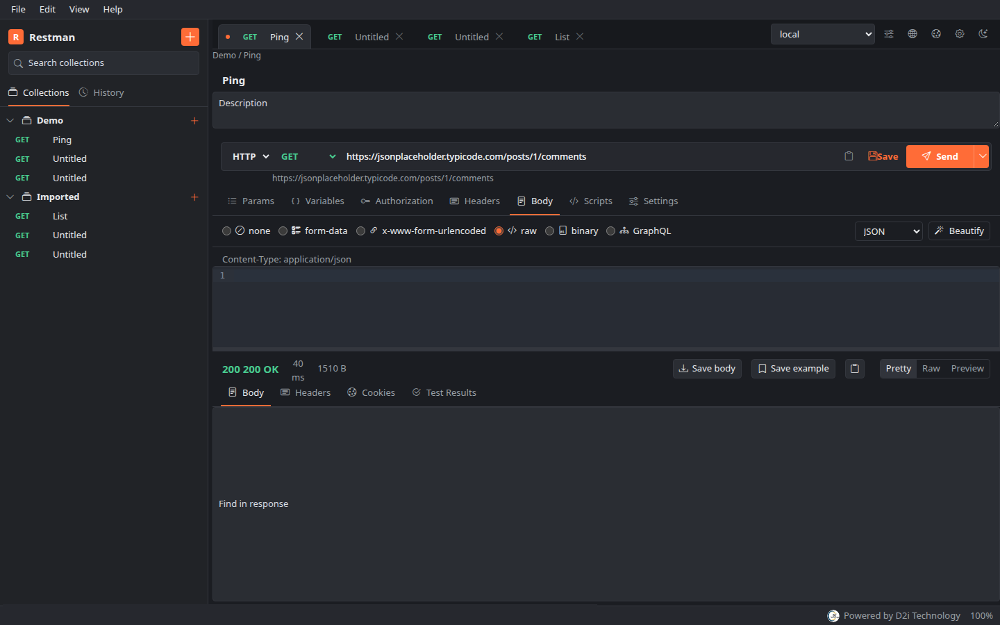

# Restman

Restman is a local API client for HTTP, GraphQL, and WebSocket. Collections, environments, and history stay on your computer.

Powered by [D2i Technology](https://d2itechnology.com/).

## Screenshots

Collections, tabs, and the request editor.



Request body: form-data, urlencoded, raw, binary, and GraphQL.



Response status, timing, and size.



## What you can do

- Organize requests in collections and folders, with drag and drop and a context menu.
- Use environments, globals, collection variables, and `{{placeholders}}`.
- Send HTTP with basic, bearer, API key, digest, NTLM, AWS, OAuth 1, and OAuth 2.
- Write pre-request scripts and tests with `pm`.
- Run a collection, including a subset of requests and a data file.
- Import and export Postman Collection v2.1, including v1 collections on import, and Postman environments.
- Copy a request as cURL, JavaScript, Python, Go, and other languages.
- Connect a WebSocket and inspect timing, cookies, and history.

Linux, Windows, and macOS each open Restman in its own window. Windows uses the Edge WebView2 runtime, which is included with Windows 11.

## Download

Installers for 1.0.0 are on the [GitHub release](https://github.com/ashish9868/restman/releases/tag/v1.0.0).

| File | Platform |
| --- | --- |
| `restman_1.0.0_linux_amd64.deb` | Linux, native window |
| `restman_1.0.0_windows_amd64_setup.exe` | Windows installer |
| `restman_1.0.0_windows_amd64.zip` | Windows, unzip and run |
| `restman_1.0.0_darwin_universal.dmg` | macOS, Intel and Apple silicon |
| `restman_1.0.0_darwin_arm64.tar.gz` | macOS app archive |
| `restman_1.0.0_darwin_amd64.tar.gz` | macOS app archive |

`SHA256SUMS` is attached to the same release.

On Debian or Ubuntu:

```bash
sudo apt install ./restman_1.0.0_linux_amd64.deb
restman
```

On a Mac, open the disk image and drag Restman onto the Applications folder. The first launch from anywhere else asks to move it there.

On Windows, run the setup executable. It installs Restman into Program Files and adds a Start menu shortcut.

The first launch creates a workspace at `~/Restman` (`%USERPROFILE%\Restman` on Windows).

## Build

Packaging for all three desktops is described in [ship.md](ship.md).

```bash
./scripts/package.sh
```

To run from source on Linux:

```bash
sudo apt install libgtk-3-dev libwebkit2gtk-4.1-dev pkg-config
cd frontend && npm ci && npm run build && cd ..
go build -o bin/restman .
./bin/restman
```
