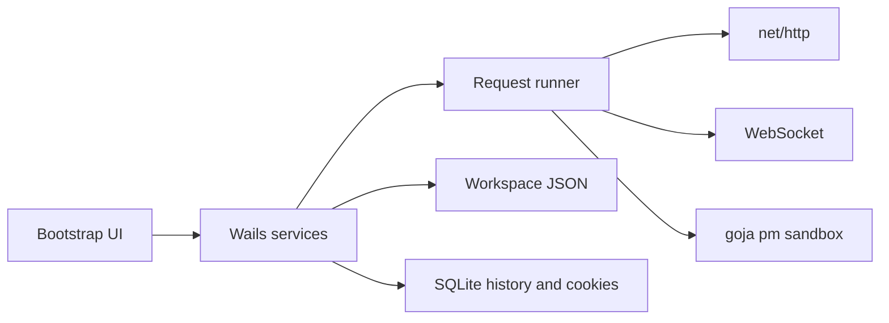

# Restman local API client

Greenfield app in this repository. One desktop binary for Linux, macOS, and Windows. No accounts, cloud sync, teams, monitors, mocks, billing, or SSO.

## Stack

- **Shell:** [Wails v3](https://v3.wails.io/) pinned to the current beta (`v3.0.0-beta.30` or newer at implementation time). The desktop API is stable; v3 uses the OS webview (WebView2, WKWebView, WebKitGTK) so the app stays small and starts quickly. Native menus, file dialogs, and keyboard shortcuts come from Wails, not a custom browser frame.
- **UI:** Bootstrap 5.3 for layout, forms, tabs, and theme. Vanilla ES modules for behavior. [CodeMirror 6](https://codemirror.net/) only for body, GraphQL, script, and response editors. No React or Electron.
- **HTTP:** Go `net/http` plus `httptrace` for timing. WebSocket via `coder/websocket`.
- **Scripts:** [`dop251/goja`](https://github.com/dop251/goja) on a fresh VM per run, with an interrupt timeout (5s) and no filesystem, DOM, or `require`.
- **Files:** git-friendly JSON for collections and environments. `modernc.org/sqlite` (pure Go) only for history, cookie jar, and window state under the OS config directory.

## What v1 does

- HTTP methods GET, POST, PUT, PATCH, DELETE, HEAD, OPTIONS. Bodies: none, JSON/text/XML/HTML raw, form-urlencoded, multipart, binary file.
- GraphQL mode: query, variables, operation name, sent as HTTP.
- WebSocket tab: connect, send text or binary, message log, close.
- Collections as a folder tree, multi-request tabs, save, duplicate, delete.
- Variables with Postman-style `{{name}}` and the usual dynamic ones (`$guid`, `$timestamp`, `$isoTimestamp`, `$randomInt`). Resolution order: request, environment, collection, global.
- Auth on request, folder, or collection, with inherit: none, basic, bearer, API key (header or query), OAuth2 client-credentials and auth-code via a localhost redirect. Tokens stay in the workspace.
- Pre-request and test scripts. Supported `pm` surface: `environment`, `globals`, `collectionVariables`, `variables`, `request` (url, method, headers, body), `response` (`code`, `json()`, `text()`, headers, `responseTime`), `test`, `expect` (`equal`, `eql`, `property`, `include`, `status`), and `sendRequest` with a depth cap of 3.
- Sequential collection or folder runner that shows each request’s status and test results.
- Import and export Postman Collection v2.1 and Postman environment JSON.
- History, cookie jar, timeout, redirect toggle, proxy, skip-TLS-verify, client certificate.
- Native menu, system light/dark, shortcuts: Ctrl/Cmd+Enter send, Ctrl/Cmd+N new, Ctrl/Cmd+S save, Ctrl/Cmd+W close tab.

Left out on purpose: login, workspaces-as-a-service, role control, API network, cloud monitors, mock servers, Flows, comments, forks, billing, and AI assistants.

## Layout



Workspace (user-chosen directory, default `~/Restman`, safe to commit):

- `restman.json` — workspace name and active environment id
- `collections/<slug>/collection.json` plus one JSON file per folder and request
- `environments/<slug>.json`
- `globals.json`

App data (not in the workspace): SQLite for history, cookies, open tabs, and window bounds.

Request file shape (illustrative):

```json
{
  "id": "uuid",
  "name": "List pets",
  "method": "GET",
  "url": "{{baseUrl}}/pets",
  "params": [],
  "headers": [],
  "auth": { "type": "inherit" },
  "body": { "mode": "none" },
  "scripts": { "prerequest": "", "test": "" }
}
```

## UI

Postman-like three pane window, Bootstrap only:

- Left: Collections and History, filter box, nested tree.
- Center: tab strip, method select, URL, Send / Cancel. Sub-tabs for Params, Auth, Headers, Body, Scripts.
- Bottom: status, time, size; Body / Headers / Cookies / Test results. WebSocket uses the same tab with a message pane instead of an HTTP response.

Go services the UI calls: `Workspace`, `Collections`, `Runner`, `Scripts`, `History`, `Cookies`, `Importer`, `Settings`. Events stream response progress and runner results back to the page.

## Build order

1. Wails v3 shell, Bootstrap chrome, empty request tab, native menu and theme.
2. HTTP runner and response viewer, including cancel, timing, and size.
3. On-disk collections, tabs, and save.
4. Environments, globals, `{{var}}` substitution, and auth.
5. Postman v2.1 and environment import/export.
6. History, cookies, proxy, TLS, and client certs.
7. goja `pm` sandbox, test panel, and collection runner.
8. GraphQL body mode and WebSocket client.
9. Shortcuts, empty states, and `wails3` packaging notes for the three desktops.

Linux builds need WebKitGTK (GTK4/WebKit 6 by default on v3; GTK3 remains available). Windows needs the WebView2 runtime, which current Windows already has. macOS uses the system WebKit.

## Run and package

The UI is Bootstrap 5, built with Vite, and served by the Go process on `127.0.0.1`. Collections stay in the workspace folder. History and cookies stay in the OS config directory. The native window is a Wails v3 shell around that same local UI.

```bash
cd frontend && npm install && npm run build && cd ..
go build -o bin/restman .
./bin/restman
```

On Linux, `./bin/restman` opens a native GTK window. `-workspace /path/to/folder` chooses the collection directory. The default is `~/Restman`.

```bash
sudo apt install libgtk-3-dev libwebkit2gtk-4.1-dev pkg-config
go build -o bin/restman .
./bin/restman
```

`go build -tags browser` keeps the UI on `http://127.0.0.1:8787` without a window. Windows and macOS currently use that browser mode until the WebView shell is built there.
